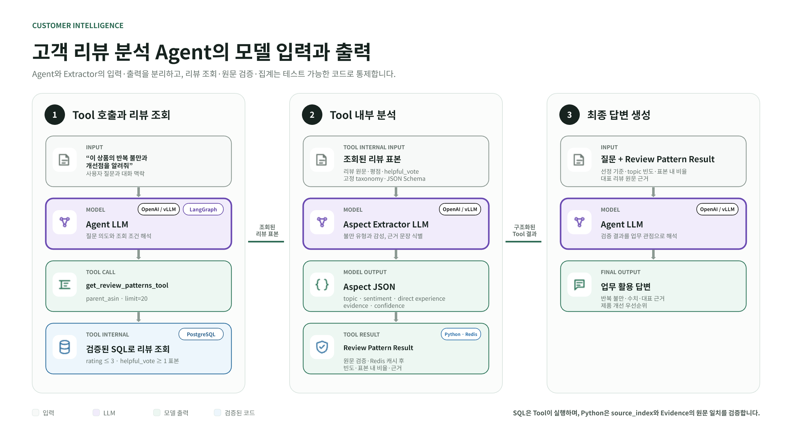
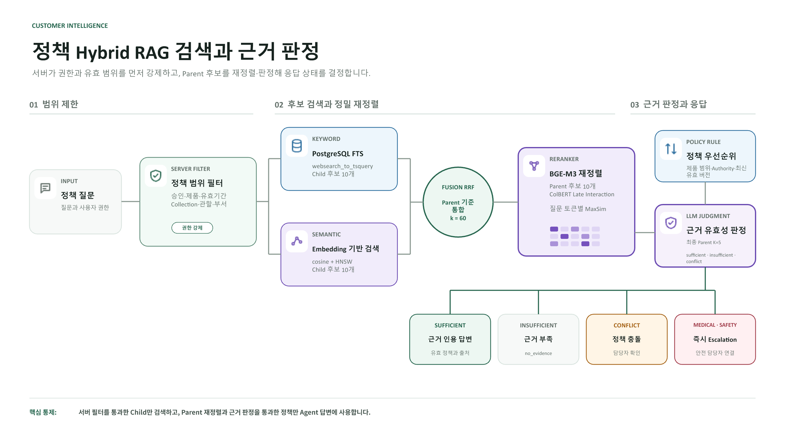
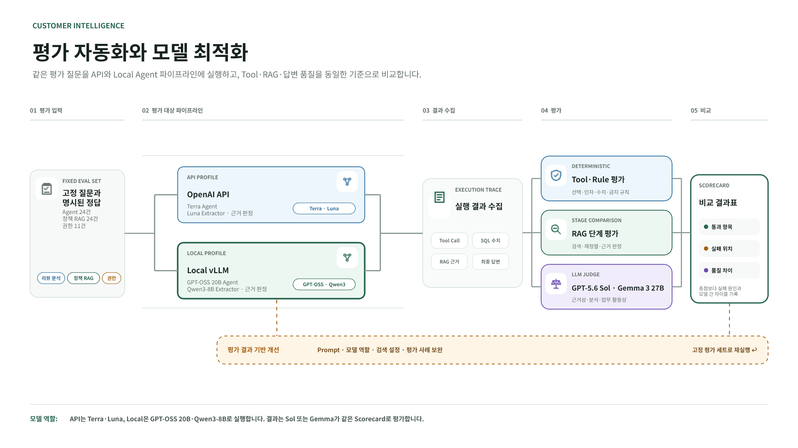

<h1 align="center">Customer Intelligence Agent</h1>

<p align="center">
  <strong>고객 리뷰의 정량 지표와 원문 근거, 적용 가능한 사내 정책을 한 대화에서 확인하는 에이전트</strong><br>
  LLM은 해석에 활용하고, 수치와 권한, 근거는 코드로 검증합니다.
</p>

<p align="center">
  <a href="https://www.python.org/"></a>
  <a href="https://fastapi.tiangolo.com/"></a>
  <a href="https://nextjs.org/"></a>
  <a href="https://www.postgresql.org/"></a>
  <a href="https://redis.io/"></a>
  <a href="https://www.docker.com/"></a>
</p>

<p align="center">
  <a href="#시연-영상">시연 영상</a> ·
  <a href="#문제와-설계">문제와 설계</a> ·
  <a href="#시스템-흐름">시스템 흐름</a> ·
  <a href="#평가-결과">평가 결과</a> ·
  <a href="#빠른-실행">빠른 실행</a> ·
  <a href="README_EN.md">English</a>
</p>

## 시연 영상

상품 리뷰에서 반복 불만과 원문 근거를 찾고, 꼬리질문으로 개선 우선순위를 정한 뒤,
승인된 정책을 검색하거나 근거가 없을 때 답변을 보류하는 전체 흐름을 보여줍니다.

https://github.com/user-attachments/assets/d459e612-e743-4946-9406-4c99570e58e6

<p align="center">
  <sub>
    <a href="docs/demo/customer-intelligence-demo-ko.mp4">전체 시연 영상 보기 (4분 33초)</a> ·
    <a href="docs/demo/customer-intelligence-demo-ko.srt">한국어 자막</a>
  </sub>
</p>

> **구현 범위** — Amazon Reviews 2023 Beauty and Personal Care의 샴푸 상품
> 547개와 리뷰 105,060건을 분석 대상으로 구성했습니다. 저장소의 정책은 실제 회사
> 문서가 아닌 포트폴리오 검증용 합성 데이터입니다.

## 문제와 설계

대량의 리뷰에서 통계를 계산하고 개선 신호를 찾은 뒤, 관련 정책까지 별도로 검색하는
업무는 시간이 오래 걸립니다. 이 프로젝트는 그 과정을 하나의 대화로 연결하되,
LLM이 수치나 정책을 임의로 만들지 못하도록 책임을 분리했습니다.

| 보장하려는 것 | 적용한 설계 | 결과 |
|---|---|---|
| **정확한 수치** | LLM은 SQL을 만들지 않고 검증된 SQL Tool만 선택 | 조회 조건과 집계 기준을 일관되게 유지 |
| **추적 가능한 근거** | Aspect 근거를 리뷰 원문과 대조하고 정책은 Hybrid RAG로 검색 | 반복 불만과 정책 답변의 출처를 확인 가능 |
| **통제된 의사결정** | 권한·관할·유효기간을 서버에서 강제하고 근거를 별도 판정 | 권한 밖 문서 노출과 근거 없는 정책 안내를 차단 |

## 시스템 흐름

### 1. 고객 리뷰 분석



Agent가 질문에 맞는 SQL Tool을 선택하면 PostgreSQL이 통계와 리뷰 표본을 반환합니다.
Aspect Extractor는 리뷰별 불만 유형·감성·근거 구절을 구조화하고, Python은 근거가
원문에 실제로 존재하는지 확인한 뒤 빈도와 표본 내 비율을 집계합니다. Agent는
이 검증된 결과만 사용합니다.

[고객 리뷰 분석 문서](docs/review-analysis/README.md)에서 Extractor 스키마, 원문 검증,
Redis 캐시와 리뷰별 호출의 비용·정확도 trade-off를 확인할 수 있습니다.

### 2. 정책 Hybrid RAG



서버가 승인 상태, 유효기간, 상품, Collection, 관할, 부서와 사용자 권한을 먼저
적용합니다. PostgreSQL FTS와 Embedding 검색이 각각 Child 후보를 찾고, RRF가 Parent
기준으로 결합합니다. BGE-M3가 관련 조항을 재정렬한 뒤 구조화 LLM이 근거를
`sufficient / insufficient / conflict`로 판정합니다.

[정책 RAG 문서](docs/rag/README.md)에서 Child·Parent 역할, RRF, BGE-M3 MaxSim,
정책 우선순위와 실패 처리를 확인할 수 있습니다.

## 시연에서 확인할 수 있는 결과

리뷰 분석은 선택된 표본의 반복 불만과 실제 언급 문장을 함께 보여주며, 표본 비율을
전체 고객 발생률로 확대하지 않습니다. 정책 답변은 적용 가능한 조항을 출처와 함께
제시하고, 근거가 부족하면 내용을 추측하지 않고 `no_evidence`로 종료합니다.

## 평가 결과

평가는 RAG 엔진과 Agent를 분리해 확인합니다. 먼저 24개 고정 정책 질문을 Agent 없이
Retriever에 직접 입력해 FTS, Vector, RRF, BGE-M3와 근거 판별의 효과를 같은 조건에서
비교합니다. 이어서 실제 사용자 질문 9개를 Agent에 입력해 Tool 선택뿐 아니라 검색어와
상품·부서·관할 필터를 올바르게 구성하는지 확인합니다.

| 평가 세트 | 확인하려는 질문 | Agent 개입 | 주요 지표 |
|---|---|---|---|
| RAG 파이프라인 24건 | 검색 엔진이 정답 정책과 정확한 조항을 찾는가 | 없음 | Recall@5, MRR, 정답 조항 Parent Hit, 상태 정확도, 지연시간 |
| 정책 Agent 9건 | Agent가 RAG를 올바른 Tool과 인자로 사용하는가 | 있음 | Tool 실행, 정책 상태·출처·조항·사실, 답변 근거성 |

이 구분을 통해 검색 엔진의 실패와 Agent가 검색 요청을 잘못 구성한 실패를 분리할 수
있습니다. 최종 검색 단위는 Parent Chunk이며, 정확한 조항의 포함 여부는 변하기 쉬운
DB Chunk ID 대신 Parent에 연결된 `source_id + rule_key` 조합으로 검사합니다.



| Pipeline | Source Recall@5 | Source MRR | 정답 조항 Parent Hit@5 | 정답 조항 Parent MRR | 상태 정확도 | No-evidence F1 | p95 |
|---|---:|---:|---:|---:|---:|---:|---:|
| FTS Only | **1.000** | 0.865 | 0.875 | 0.708 | 0.833 | 0.667 | 94.3 ms |
| Vector Only | 0.875 | 0.812 | 0.875 | 0.812 | 0.833 | 0.714 | **76.5 ms** |
| Hybrid RRF | **1.000** | 0.896 | **1.000** | 0.896 | 0.833 | 0.667 | 116.8 ms |
| Hybrid RRF + BGE-M3 | **1.000** | 0.969 | **1.000** | 0.880 | 0.833 | 0.667 | 1,139.9 ms |
| 전체 파이프라인 + 근거 판별 | **1.000** | **1.000** | **1.000** | **0.969** | **1.000** | **1.000** | 5,195.6 ms |

### Ablation 결과 해석

- **FTS Only:** 정책 문구와 숫자가 질문에 그대로 포함될 때 강했습니다. 정책 문서는 모두
  찾았지만, 정확한 조항을 상위에 둔 비율은 상대적으로 낮았습니다(Parent MRR 0.708).

- **Vector Only:** 표현이 다른 질문에서 조항 순위가 개선됐습니다(MRR 0.812). 반면 정확한
  숫자나 정책 용어가 중요한 일부 질문을 놓쳐 Source Recall@5는 0.875였습니다.

- **Hybrid RRF:** 두 검색 결과를 합치자 정책 문서와 정답 조항을 모두 찾았고, 조항 MRR도
  0.896으로 올랐습니다. 키워드 검색과 의미 검색이 서로의 누락을 보완한 결과입니다.

- **Hybrid RRF + BGE-M3:** 정답 정책의 순위는 개선됐지만(Source MRR 0.969), 조항 MRR은
  0.880으로 소폭 낮아졌습니다. 같은 정책 안의 유사한 조항이 정답보다 앞선 경우가 있어,
  재정렬이 모든 지표를 항상 높이지는 않았습니다.

- **전체 파이프라인:** 검색 결과가 질문에 직접 답할 수 있는지 한 번 더 확인해 정확도와
  No-evidence F1이 모두 1.000이 됐습니다. 대신 p95 응답 시간은 1.14초에서 5.20초로
  늘어 정확도와 지연시간의 교환 관계가 나타났습니다.

결과적으로 **후보 검색은 Hybrid RRF**, **정답 정책의 상위 배치는 BGE-M3**, **근거가
부족한 답변의 차단은 전체 파이프라인**이 가장 효과적이었습니다. 지연시간은 각 검색 단계를
공정하게 비교하기 위해 공통 질문 Embedding 생성 시간을 제외했습니다.

정책 Agent 9건에서는 Tool 선택과 실행이 모두 통과했고 BGE-M3와 근거 판별 오류도
없었습니다. 그러나 기대한 정책 상태는 5건, 정답 출처와 조항은 각각 6건만 일치했습니다.
이는 RAG 엔진의 실패라기보다 Agent가 자연어 부서명 `품질팀`을 DB 값 `CS`로
정규화하지 않거나, 질문을 지나치게 넓게 재작성한 문제를 드러냅니다.

| 정책 Agent 평가 | 결과 |
|---|---:|
| Tool 선택·실행 | **9/9** |
| BGE-M3 / 근거 판별 오류 | **0/9 / 0/9** |
| 기대 정책 상태 일치 | 5/9 |
| 정답 정책 출처 / 조항 포함 | 6/9 / 6/9 |
| 정답 사실 포함 | 7/9 |
| `no_evidence` 답변 보류 | **9/9** |
| GPT-5.6 Sol 평균 평가 | 4.56/5 |

- **직접 검색과 Agent의 차이:** 정해진 조건으로 검색한 24건은 정답 조항을 모두 찾았지만,
  Agent 9건은 질문을 검색 조건으로 바꾸는 과정에서 정확도가 낮아졌습니다.

- **주요 실패 원인:** 부서명을 DB 검색값으로 바꾸지 못한 2건과, 질문 범위를 넓혀 관련성이
  약한 정책을 찾은 1건이 확인됐습니다.

- **평가 기준 보완:** 존재하지 않는 보상 기준을 묻는 질문에서 Agent는 답을 만들지 않았지만,
  관련 정책을 함께 보여줘 정답과 불일치했습니다. 안전한 답변과 오답을 구분하도록 기준을
  보완할 필요가 있습니다.

- **다음 실험:** 검색 전에 부서·관할 값을 표준화하고 질문 재작성 범위를 제한한 뒤, 같은
  9건에서 상태·출처·조항 정확도가 개선되는지 확인합니다.

RAG 24건의 모든 단계는 채널별 후보 10개와 최종 Parent `K=5`라는 같은 조건을
사용했습니다.
별도 정책 권한 평가 11건에서는 허용 정책 Recall@5 1.000, 차단 정확도 1.000,
권한 밖 문서 노출 0건을 확인했습니다. 다만 작은 합성 정책 세트의 결과이므로 일반
질문 전체의 정확도를 의미하지 않습니다. 실험 목적, 정답 데이터와 재현 방법은
[평가 안내](eval/README.md)에 정리했으며, 공개 범위를 줄인 최종 수치는
[평가 결과 요약](docs/results/README.md)에서 확인할 수 있습니다.

## 빠른 실행

저장소 루트에서 `.env.example`을 복사하고 실제 비밀값은 Git에서 제외되는 `.env`에만
입력합니다.

```powershell
Copy-Item .env.example .env
docker compose --env-file .env `
  -f deploy/compose/local-infra.yaml `
  -f deploy/compose/local-app.yaml up --build
```

- Web: `http://localhost:3000`
- API 준비 상태: `http://localhost:8000/api/ready`

```powershell
pytest -q
python -m eval.run_agent_evaluation
python -m eval.rag_pipeline_comparison
```

Agent와 전체 RAG 평가는 PostgreSQL 데이터와 OpenAI API 설정이 필요합니다. 세부 옵션,
비용이 발생하는 검증과 로컬 모델 실행은 [실행과 배포 문서](deploy/README.md)와
[평가 안내](eval/README.md)에 분리했습니다.

Amazon 리뷰 분석 데이터를 처음부터 만들고 PostgreSQL에 적재하려면
[데이터 재현 안내](docs/data_reproduction.md)를 따릅니다. 원본 데이터는 저장소에
포함하지 않으며, 필터 노트북과 동일한 로직의 실행 스크립트로 상품 547개와 리뷰
105,060개를 재현합니다.

## 기술 구성

| 영역 | 기술 |
|---|---|
| Agent와 분석 | Python, LangGraph, LangChain, Pydantic, pandas |
| 정책 검색 | PostgreSQL FTS, pgvector, RRF, BGE-M3 ColBERT MaxSim |
| Web과 인증 | FastAPI, Next.js, TypeScript, Google OIDC, HttpOnly Cookie |
| 상태와 기록 | Redis, PostgreSQL 대화·출처·감사 로그 |
| 배포와 평가 | Docker Compose, Terraform, EC2, ECR, pytest, LLM Judge |

<details>
<summary><strong>설계 원칙 보기</strong></summary>

- SQL 정확성, 정책 권한, 원문 근거와 안전 경계는 코드가 보장합니다.
- 언어적 해석 품질은 모델 교체와 평가 세트로 관리합니다.
- Tool 결과에 없는 수치, 정책, 인과관계와 안전성 정보를 생성하지 않습니다.
- 동일 우선순위 정책이 충돌하면 Agent가 임의로 결론을 선택하지 않습니다.
- 의료·안전 질문은 일반 답변과 분리해 사람의 검토로 전환합니다.
- OpenAI와 로컬 모델은 같은 Tool, 스키마와 평가 계약을 사용합니다.

</details>

<details>
<summary><strong>실행 프로필 보기</strong></summary>

| 프로필 | 목적 | 구성 | 검증 상태 |
|---|---|---|---|
| Docker 재현 환경 | 코드 리뷰와 주요 기능 재현 | Next.js, FastAPI, PostgreSQL, Redis, OpenAI API | 주요 경로와 회귀 테스트 확인 |
| AWS GPU 검증 환경 | 오픈 모델과 재정렬기 호환성 확인 | EC2 L40S, vLLM, Qwen3, GPT-OSS, BGE-M3 | 대표 상품 분석과 정책 RAG Smoke Test 완료 |
| 상시 운영 환경 | 공개 서비스 운영 | 별도 비용·보안·관측성 정책 필요 | 포트폴리오 범위에서 제외 |

GPU 서비스는 상시 공개하지 않습니다. Terraform으로 필요한 시점에 EC2 환경을 만들고
대표 경로를 확인한 뒤 비용 자원을 제거했습니다. 따라서 `localhost`는 배포 한계가
아니라 저장소를 같은 조건으로 실행하기 위한 재현용 진입점입니다.

</details>

<details>
<summary><strong>프로젝트 구조 보기</strong></summary>

```text
customer-intelligence/
├─ backend/                 # FastAPI API, 인증, 대화와 작업 관리
├─ frontend/                # Next.js 사용자 화면
├─ src/                     # Agent와 핵심 분석 로직
│  ├─ analysis/             # Aspect 추출, 원문 검증과 패턴 집계
│  ├─ rag/                  # 정책 검색, RRF, 재정렬과 근거 판정
│  ├─ prompts/              # Agent 지침과 Grounding 규칙
│  ├─ llm/                  # OpenAI와 vLLM 호출 인터페이스
│  ├─ auth/                 # 인증, 세션과 접근 제어
│  └─ cache/                # Redis 기반 리뷰 분석 캐시
├─ db/                      # PostgreSQL 스키마와 초기화 SQL
├─ data/                    # 합성 정책과 로컬 전용 Amazon 리뷰 데이터
├─ notebooks/               # 데이터 필터링과 Colab 검증 노트북
├─ scripts/                 # 데이터 생성과 PostgreSQL 적재 스크립트
├─ eval/                    # Agent, RAG와 LLM Judge 평가
├─ tests/                   # Tool, 분석, 권한과 회귀 테스트
├─ deploy/                  # Docker Compose와 AWS 배포 스크립트
├─ infra/terraform/         # EC2, ECR과 네트워크 정의
└─ docs/                    # 상세 설계 문서, 다이어그램과 화면 이미지
```

</details>

## 문서 안내

| 문서 | 확인할 내용 |
|---|---|
| [고객 리뷰 분석](docs/review-analysis/README.md) | SQL 표본, Aspect Extraction, 원문 검증, 집계와 Redis 캐시 |
| [정책 RAG](docs/rag/README.md) | Ingestion, Child·Parent 검색, RRF, BGE-M3와 근거 판정 |
| [평가](eval/README.md) | Agent·Tool·RAG 평가 목적, 실행 명령과 결과 파일 |
| [데이터 재현](docs/data_reproduction.md) | Amazon 원본, 필터 기준, Parquet 생성과 DB 적재 |
| [실행과 배포](deploy/README.md) | 로컬 Compose, ECR 이미지 게시와 EC2 배포 |
| [Terraform](infra/terraform/README.md) | 비용 안전 기본값, EC2 생성, SSM 접속과 종료 |
| [Web 구조](docs/web_architecture.md) | Next.js, FastAPI, OIDC, 세션과 RBAC 경계 |
| [모델 런타임](docs/local_model_runtime.md) | OpenAI, Qwen, GPT-OSS, Gemma 역할과 전환 구조 |
| [핵심 설계 결정](docs/adr/001-review-analysis-and-policy-rag.md) | 리뷰 SQL Tool과 정책 Hybrid RAG를 분리한 이유 |

## 데이터와 현재 상태

Amazon Reviews 2023 원본 전체는 저장소에 재배포하지 않습니다. 실제 `.env`, OAuth
Secret, API Key, DB 내용과 Terraform state도 Git에 포함하지 않습니다.

분석 데이터의 선정 근거와 재현 절차는 [데이터 재현 안내](docs/data_reproduction.md)에
공개했습니다. `analyzed_asin`은 필터 결과를 추적하는 열이며, 애플리케이션 DB는 기존
`parent_asin`을 상품 키로 사용합니다.

OpenAI 기반 Web·Agent·정책 검색과 주요 평가 경로를 구현했습니다. AWS L40S에서
Qwen3와 GPT-OSS의 대표 상품 분석 경로, BGE-M3 재정렬 API를 검증했습니다. 로컬 모델
전체 평가와 운영 수준의 관측성·스트리밍은 후속 범위입니다.
